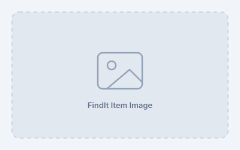

# FindIt – University Lost & Found Portal

**Official Campus Lost and Misplaced Belongings Management Web Platform**  
**Institution:** MAWTS Institute of Technology (Configurable)  
**Academic Supervisor:** Joy Debnath  
**Team:** Group 3  

---

## 1. Project Introduction
**FindIt** is a production-quality, university-exclusive web portal engineered for **MAWTS Institute of Technology**. Misplacing valuable items on campus (such as student smart IDs, backpacks, calculators, and wireless electronics) frequently disrupts academic activities. FindIt solves this by providing a unified, secure platform where students and faculty can:

1. **Report Lost Items** with exact campus locations, dates, and photographic proof.
2. **Register Found Items** equipped with a **Cryptographic Ownership Challenge** (secret question & answer) so that only the true owner can unlock the finder's contact details.
3. **Prevent Fraud & Protect Privacy:** The database hashes secret answers using Bcrypt; phone numbers and contact details remain invisible to unverified users and general public queries.
4. **Foster Honest Campus Culture (Gamification):** Finders earn 50 recognition points and honor badges (e.g. *Campus Guardian Gold*, *Silver Returner*, *Campus Helper*) when an item is confirmed safely returned.

---

## 2. Key Features

- **University SaaS Design Language:** Modern, trustworthy aesthetic with light and dark mode toggling (saved to `localStorage`).
- **Comprehensive Multi-Filter Search:** Filter active reports by keyword, category (Bag, Phone, ID Card, Books, Keys, Other), incident date, campus location, and sort by newest/oldest.
- **Secret Ownership Verification:** Found items require a verification challenge. Answering correctly reveals the finder's contact info; incorrect guesses are rate-limited to 5 attempts with a 15-minute security lockout.
- **Zero-Knowledge Contact Privacy:** Safe public views (`public_items` and `public_leaderboard`) completely strip secret answer hashes and private phone numbers from client queries.
- **Automated 30-Day Archival:** Items older than 30 days are automatically archived dynamically and excluded from default active searches.
- **Client & Server Security:**
  - Client-side image validation (MIME types only, strictly <= 2 MB).
  - DOM-based XSS prevention (strictly using `textContent` and `createElement`, never injecting raw user strings into `innerHTML`).
  - Protected route guards (`requireAuth`) redirecting unauthenticated users while preserving original destination URLs.
  - Exactly-once points awarding enforced by PostgreSQL database triggers.
- **Visual Status Lifecycle:** Intuitive 3-step progress timeline on each report (Reported → Claim Verified → Safely Returned).
- **Responsive Mobile-First Architecture:** Fluid layouts, mobile navigation drawer, SVG icons (zero emoji for UI controls).

---

## 3. Technology Stack

- **Frontend:**
  - Semantic HTML5
  - Modern CSS3 (Custom Properties / Design Tokens, Flexbox, CSS Grid)
  - Vanilla JavaScript (ES6+ Modules, Async/Await)
  - Official Supabase JavaScript SDK v2 loaded via CDN:  
    `<script src="https://cdn.jsdelivr.net/npm/@supabase/supabase-js@2"></script>`
  - *No frontend frameworks (No React, Vue, Angular, Next.js, or bundlers required).*
- **Backend & Database:**
  - Supabase PostgreSQL 15+
  - PostgreSQL Row Level Security (RLS) on all exposed tables.
  - PostgreSQL `SECURITY DEFINER` RPC functions (`post_item`, `verify_and_get_contact`).
  - `pgcrypto` Bcrypt hashing and `uuid-ossp` identifiers.
  - Supabase Storage (`item-images` bucket with folder-level UID policies).
  - Supabase Authentication (Email & Password, Metadata Sync via Triggers).
- **Deployment:**
  - Primary: Vercel static hosting (`vercel.json`).
  - Alternative: Netlify or Cloudflare Pages.

---

## 4. Visual Preview & Screenshots

| Homepage & Hero Search | Browse & Multi-Filter Catalog |
| :---: | :---: |
|  |  |

| Item Details & Ownership Verification | Student Dashboard & Recognition |
| :---: | :---: |
|  |  |

---

## 5. Repository Attribution & Open Source Audit

During Phase 1, existing public campus Lost & Found repositories were audited:
- `zeegma/bark`: Distributed under **CC BY-ND 4.0** (Creative Commons Attribution-NoDerivatives 4.0 International). Because NoDerivatives licenses legally forbid modifications, adaptions, or creating derivative works, it was strictly rejected.
- `grcllm/ISKOpe`: Legacy PHP monolithic architecture without open permissive licensing.
- `rafiapanjwani7-afk/lost-and-found-app`: Missing backend security and authentication.

**Verdict:** To guarantee 100% legal compliance and satisfy the strict Vanilla JS + Supabase PostgreSQL stack requirements, Group 3 designed and implemented **FindIt from scratch** with a bespoke brand identity and custom database security architecture. Details are documented in [LICENSE-ATTRIBUTION.md](LICENSE-ATTRIBUTION.md).

---

## 6. Local Setup & Installation

### Step 1: Clone or Download the Workspace
```bash
git clone <your-repository-url> findit
cd findit
```

### Step 2: Configure Supabase Credentials
Open `config.js` in your code editor. Replace the placeholder values with your Supabase Project settings:

```javascript
const CONFIG = {
  INSTITUTION_NAME: 'MAWTS Institute of Technology',
  INSTITUTION_SHORT: 'MAWTS',
  
  // Replace these with your project values:
  SUPABASE_URL: 'https://your-project-id.supabase.co',
  SUPABASE_ANON_KEY: 'your-actual-supabase-anon-key',
  
  STORAGE_BUCKET_NAME: 'item-images',
  MAX_IMAGE_SIZE_BYTES: 2 * 1024 * 1024,
  // ...
};
```
> [!CAUTION]
> Never put your Supabase `service_role` secret key or database master password into `config.js`. Only provide the public `anon` key!

### Step 3: Run with a Local Static Server
Because FindIt uses standard ES6 JavaScript and HTML5, you do not need Node.js or `npm install`.

**Option A — VS Code Live Server (Recommended):**
1. Open the `findit` folder in Visual Studio Code.
2. Install the **Live Server** extension (by Ritwick Dey).
3. Right-click `index.html` and choose **"Open with Live Server"**.
4. The site will open at `http://127.0.0.1:5500/index.html`.

**Option B — Python 3 Built-in HTTP Server:**
```bash
# In the project root directory:
python -m http.server 8000
```
Open `http://localhost:8000` in your web browser.

---

## 7. Supabase Database & Storage Setup Guide

Follow these steps to configure your free Supabase project:

### 1. Create a Supabase Project
1. Log in to [https://supabase.com](https://supabase.com) and click **"New Project"**.
2. Set a project name (e.g. `FindIt-MAWTS`), set a secure database password, and pick a nearby region.
3. Once the database finishes provisioning, navigate to **Project Settings** -> **API**.
4. Copy the **Project URL** and the **`anon` `public` key** and paste them into `config.js`.

### 2. Execute SQL Migrations
1. In the Supabase Dashboard, open the **SQL Editor** from the left navigation.
2. Click **"New query"**.
3. Open [`supabase/schema.sql`](supabase/schema.sql) in this repository, copy its entire contents, paste it into the SQL Editor, and click **"Run"**.
4. This will create:
   - Tables: `profiles`, `items`, `claims`, `verification_attempts`
   - Safe Views: `public_items`, `public_leaderboard`
   - Stored Procedures & Triggers: `handle_new_user`, `handle_points_award`
   - Secure RPCs: `post_item`, `verify_and_get_contact`
   - Row Level Security (RLS) policies

### 3. Verify Storage Bucket (`item-images`)
`supabase/schema.sql` automatically configures the `item-images` storage bucket and sets folder-level ownership policies.  
To verify:
1. Go to **Storage** in the Supabase sidebar.
2. Confirm that a bucket named `item-images` exists and is marked **Public**.

### 4. Configure Supabase Authentication Redirects
1. Go to **Authentication** -> **URL Configuration**.
2. Under **Site URL**, add your local or production URL:
   - Local: `http://localhost:5500` or `http://localhost:8000`
   - Production: `https://your-findit-project.vercel.app`
3. Under **Redirect URLs**, add:
   - `http://localhost:5500/**`
   - `https://your-findit-project.vercel.app/**`

### 5. (Optional) Load Campus Demo Data
1. In the Supabase **SQL Editor**, open [`supabase/seed.sql`](supabase/seed.sql).
2. Copy and run the script. It will populate 6 realistic campus demo items (backpack, student ID, earbuds, notebook, calculator, water bottle) and mock profiles.
3. To delete demo data prior to production, run:
   ```sql
   DELETE FROM public.items WHERE title LIKE '[DEMO]%';
   ```

---

## 8. Deployment Guide

### Deploying to Vercel (Primary Option)
1. Push your code to a GitHub repository.
2. Log in to [https://vercel.com](https://vercel.com) and select **"Add New Project"**.
3. Import your GitHub repository.
4. Settings:
   - **Framework Preset:** `Other`
   - **Build Command:** Leave blank (no build tool needed).
   - **Output Directory:** Leave blank (serves root directory).
5. Click **"Deploy"**.
6. Vercel automatically honors `vercel.json` for clean URLs and security headers. Your platform will be accessible via `https://<your-project>.vercel.app`.

### Deploying to Netlify
1. Log in to [https://netlify.com](https://netlify.com) -> **"Add new site"** -> **"Import an existing project"**.
2. Connect your GitHub repository.
3. Build command: None; Publish directory: `.`
4. Click **Deploy**.

### Deploying to Cloudflare Pages
1. Log in to the Cloudflare dashboard -> **Workers & Pages** -> **Create application** -> **Pages**.
2. Connect Git repository. Build output directory: `.`.
3. Click **Save and Deploy**.

---

## 9. Security Architecture & Threat Mitigation

| Security Aspect | Implementation & Enforcement |
| :--- | :--- |
| **Secret Answer Protection** | Stored exclusively as Bcrypt password hashes generated by PostgreSQL `crypt()` inside the `post_item` RPC. Plaintext answers are never stored. |
| **Zero-Knowledge API Queries** | The public queries `public_items` view, which strictly omits `verify_answer_hash` and personal phone numbers. Direct REST access to hidden columns is prevented. |
| **Brute-Force Lockout** | `verify_and_get_contact` tracks attempts in `verification_attempts`. After 5 failed guesses, the claimant account is locked out for 15 minutes. |
| **Owner-Only Mutations** | PostgreSQL RLS guarantees users can only update or delete items where `user_id = auth.uid()`. |
| **Exactly-Once Gamification** | A database trigger (`trigger_award_points`) enforces that 50 points are credited exactly once when a found item transitions to `returned`. Repeated status switches cannot duplicate points. |
| **Cross-Site Scripting (XSS)** | All user-supplied strings are escaped and injected via `textContent` or `createElementSafe`. No raw `innerHTML` concatenation is permitted. |
| **Storage Isolation** | Storage RLS policies ensure authenticated users can only write, replace, or delete files inside their own `auth.uid()` directory prefix. |

---

## 10. Free-Tier Limitations
- **Supabase Free Tier:**
  - Database pauses after 1 week of inactivity (can be unpaused from the dashboard).
  - Storage bandwidth: 2 GB monthly.
  - Image size: Capped at 2 MB in frontend validation to conserve quota.
- **Vercel Free Tier:**
  - 100 GB bandwidth per month, ample for university campus operations.

---

## 11. Troubleshooting Common Issues

1. **"Failed to load items / Listings empty"**:
   - Verify that your Supabase URL and Anon Key in `config.js` are valid and do not contain placeholder strings.
   - Confirm that you ran `supabase/schema.sql` in the Supabase SQL editor.
2. **"Image upload fails with storage error"**:
   - Confirm that the `item-images` bucket exists in your Supabase dashboard and is set to **Public**.
   - Verify that the storage RLS policies in `supabase/schema.sql` were applied.
3. **"Session expires immediately"**:
   - Ensure third-party cookies or browser extensions are not blocking `localStorage` access on your browser.

---

## 12. Team Members & Task Allocation (Group 3)

| Member | Academic Role | Primary Responsibilities |
| :--- | :--- | :--- |
| **MD Ibrahim Khalil** | Team Leader & Security Engineer | Architecture, Database Security, RPCs, Schema & Integration |
| **Adib Akanda** | UI/UX Designer & Frontend Engineer | Design System, CSS Architecture, Theme Engine, Logo SVG |
| **Konika Tripura** | Auth & Forms Developer | Supabase Auth, Route Protection, Post Item Submission |
| **Christopher Mack Dcosta** | Search & Details Developer | Catalog Multi-Filters, Pagination, Details View |
| **Akash Biswas** | Dashboard & QA Engineer | Dashboard, Status Workflow, Leaderboard & End-to-End QA |
